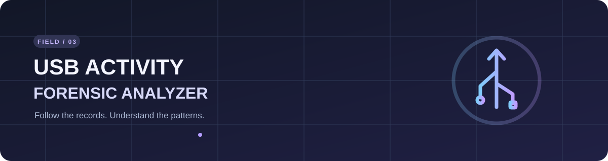

# USB Device Activity Forensic Analyzer

**Explore prepared USB activity records locally in your browser.**

[**Open the live app ↗**](https://namitesh07.github.io/usb-device-activity-forensic-analyzer/) · [Input guide](docs/INPUTS.md) · [Setup & tests](docs/SETUP.md) · [Roadmap](docs/ROADMAP.md) · [Changelog](CHANGELOG.md)

## At a glance

- **Investigate:** Preview and map multiple CSVs, then explore the timeline and device summaries.
- **Check context:** Review skipped rows, duplicate candidates, timezone issues, and per-file SHA-256 fingerprints.
- **Export:** Download filtered events, data-quality entries, or a text report. Evidence stays in your browser.

## Try it

1. [Open the app](https://namitesh07.github.io/usb-device-activity-forensic-analyzer/) and choose **Try two-file demo** or select [prepared CSVs](docs/INPUTS.md#prepared-csv-contract).
2. Review each mapping and time setting, confirm the event labels, then analyze the records.

> **Limits:** The tool reads prepared CSVs; it does not directly parse `.evtx`, Windows Event Viewer exports, registry hives, or live devices. Repeated records are leads for review, not proof of unauthorized use. [Read the evidence guide →](docs/INPUTS.md)

The original Python desktop app remains available. See [setup and testing](docs/SETUP.md) and the [upgrade roadmap](docs/ROADMAP.md).

---

Created by <strong>Namitesh Pandey</strong>

