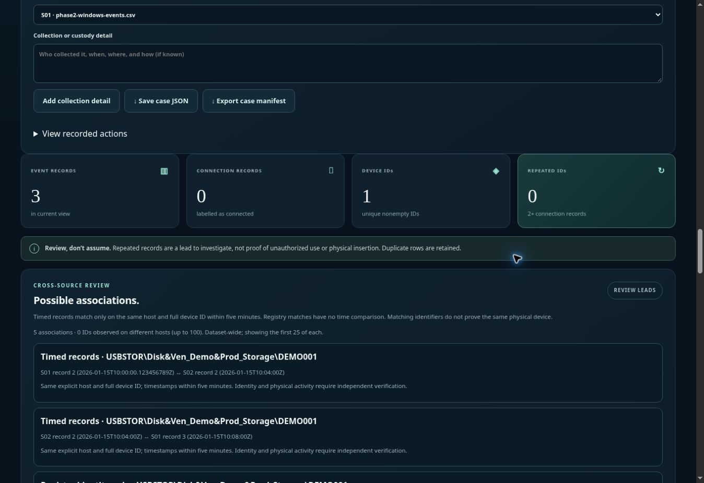

# Fictional demo and troubleshooting

## Try the Windows evidence demo

1. [Open the analyzer](https://namitesh07.github.io/usb-device-activity-forensic-analyzer/) and select **Try Windows evidence demo**. The three fictional sources illustrate Windows event records, a SetupAPI installation section, and an untimed USBSTOR registry key.
2. Review each source, its fingerprint and time setting. Check the confirmation box and select **Analyze reviewed sources**.
3. Inspect the timeline and **Possible associations**. The sample has three timed records and one registry key. The associations are leads, not proof of a physical insertion, file transfer, or unauthorized activity.
4. Try the timeline filters and **Run review rules**, then select a finding. Add an analyst note if useful.
5. Export a printable HTML report or save a case. To reopen the fictional case, download the [sample files](../samples/) and select the three original demo files alongside the case JSON. The filenames can differ, but their bytes must match.



See the [input and evidence guide](INPUTS.md) for supported formats, time zones, known-device lists, and case-file limits.

## Work from a local copy

[Download the repository ZIP](https://github.com/Namitesh07/usb-device-activity-forensic-analyzer/archive/refs/heads/main.zip), extract it, and start a local server from the extracted project folder:

```bash
python -m http.server 8000 --bind 127.0.0.1
```

Open `http://127.0.0.1:8000/`. Once downloaded, the application files and bundled EVTX parser can be served from your own computer without an internet connection. Python is used only to run the optional local server. External documentation links need internet access. The ZIP contains source files; it is not a signed desktop installer.

## Troubleshooting

- **Background import fails:** Open the site on HTTPS or serve the extracted copy from `localhost`. Check that `import-worker.js`, the JavaScript files, and the `wasm` folder are present. XML imports use the page's parser and may briefly block the interface.
- **Cancel is delayed:** The button interrupts background parsing. A file currently being read, XML parsing, or a browser without worker support may have to finish its current step first. A previous analyzed case remains available.
- **Case will not reopen:** Select every original source whose fingerprint appears in the case. The saved case is not the evidence itself. A modified source will not match.
- **SHA-256 or EVTX will not load:** Use HTTPS or localhost, a current browser, and the complete extracted folder. See [setup](SETUP.md) and the [parser notice](../wasm/NOTICE.md).
- **Results need interpretation:** Check source context, time zones, data quality, and original records. Independently verify important conclusions.
